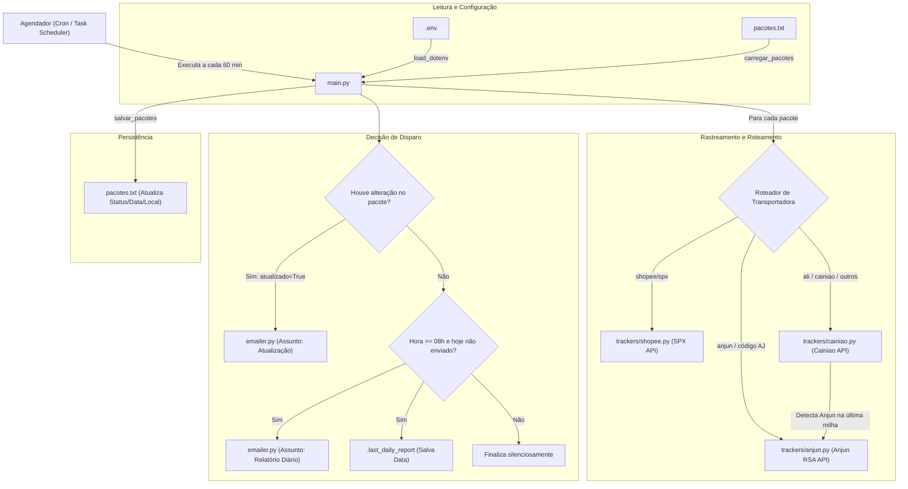

# AGENTS.md — Guia de Manutenção e Operação para Agentes de IA

Bem-vindo ao repositório do **Monitor de Rastreamento de Encomendas Multi-Transportadora**. Este documento serve como manual técnico e operacional detalhado para orientar agentes autônomos de IA e desenvolvedores que venham a inspecionar, manter, estender ou debugar este sistema.

---

## 1. Visão Geral e Propósito do Projeto

O sistema é um robô de monitoramento de fretes em Python, projetado para operar de forma autônoma e contínua em segundo plano (via Windows Task Scheduler ou Linux Cron). Ele rastreia pacotes de múltiplos e-commerces e transportadoras (**AliExpress/Cainiao**, **Shopee/SPX**, **Anjun Express Brasil** e **Correios via EDI**), detecta mudanças de status e notifica o usuário via e-mail corporativo ou pessoal.

### Metas Fundamentais de Engenharia:
- **Zero Infraestrutura Pesada**: Sem necessidade de servidores de banco de dados (PostgreSQL/MySQL) ou serviços de fila (RabbitMQ/Redis). O estado reside em arquivos locais versionáveis.
- **Portabilidade Total**: Funciona de forma idêntica em Windows (PowerShell/Batch com suporte UTF-8) e Linux (Debian 12/Ubuntu 24 com restrições PEP 668).
- **Zero Heavy-Crypto Dependencies**: Criptografia de autenticação da Anjun Express implementada em Python puro para evitar erros de compilação C ou quebra de ambiente com `externally-managed-environment`.
- **Conformidade Anti-Bot**: Respeito às políticas de segurança; não tenta quebrar CAPTCHAs como o Cloudflare Turnstile dos Correios, utilizando integrações EDI e APIs de agregação.

---

## 2. Arquitetura e Fluxo de Execução



---

## 3. Estrutura de Arquivos e Diretórios

| Arquivo / Diretório | Responsabilidade |
| :--- | :--- |
| [main.py](main.py) | Orquestrador principal: carrega pacotes, despacha rastreios, gerencia persistência de estado, avalia políticas de e-mail e processa a flag `--force`. |
| [emailer.py](emailer.py) | Cliente de envio de e-mail SMTP. Trata TLS/SSL, formatação do relatório textual limpo, suporte a `EMAIL_FROM` corporativo e inclusão de links. |
| [pacotes.txt](pacotes.txt) | Base de dados plana dos pacotes monitorados no formato com separador pipe `\|`. Preserva comentários (`#`). |
| [trackers/__init__.py](trackers/__init__.py) | Exportador do pacote de módulos de rastreamento. |
| [trackers/shopee.py](trackers/shopee.py) | Consulta a API interna da Shopee Express (SPX) com assinatura dinâmica SHA-256 e extração de cidade/hub. |
| [trackers/cainiao.py](trackers/cainiao.py) | Consulta o portal global da Cainiao/AliExpress, obtém cidade de destino final e sincroniza eventos de parceiros (Correios BR e Anjun). |
| [trackers/anjun.py](trackers/anjun.py) | Consulta a API oficial da Anjun Express com token RSA PKCS#1 v1.5 nativo em Python puro. |
| [requirements.txt](requirements.txt) | Dependências mínimas (`requests`, `python-dotenv`). |
| [run.bat](run.bat) | Script de execução para Windows com ajuste de codificação `chcp 65001` e `PYTHONUTF8=1`. |
| [run.sh](run.sh) | Script shell para Linux com detecção automática de ambiente virtual (`venv`). |
| [setup_scheduler.ps1](setup_scheduler.ps1) | Automação em PowerShell para cadastrar a tarefa agendada no Agendador de Tarefas do Windows. |
| [ADR.md](ADR.md) | Architectural Decision Records documentando as principais decisões técnicas do projeto. |
| [.env.example](.env.example) | Modelo com as variáveis de ambiente necessárias. |
| `.last_daily_report` | Arquivo marcador gerado automaticamente contendo a data do último envio de resumo diário (`YYYY-MM-DD`). |

---

## 4. Regras de Ouro e Invariantes Críticas

Ao alterar este repositório, você **DEVE** obedecer às seguintes diretrizes:

1. **NUNCA Tentar Burlar CAPTCHA ou Scrapear os Correios Diretamente**:
   - O site `rastreamento.correios.com.br` utiliza Cloudflare Turnstile CAPTCHA.
   - Qualquer tentativa de raspagem web via headless browser ou scripts falhará e viola as diretrizes de integridade e segurança.
   - A obtenção de dados dos Correios para encomendas internacionais é feita com 100% de precisão via **integração EDI no retorno da Cainiao** (`currentStatusCpInfo`).
2. **Preservar o Formato do `pacotes.txt`**:
   - O formato padrão é estritamente:
     ```text
     CODIGO | DESCRICAO | ULTIMO_STATUS | ULTIMA_DATA_HORA | LOCALIDADE
     ```
   - O código deve sempre manter compatibilidade de leitura com linhas que possuam menos colunas e nunca descartar linhas comentadas iniciadas por `#`.
3. **Manter Zero Dependências Criptográficas Externas**:
   - O arquivo [trackers/anjun.py](trackers/anjun.py) utiliza algoritmos embutidos do Python (`pow`, `os.urandom`, `base64`).
   - Não adicione `cryptography`, `rsa` ou `pycryptodome` ao `requirements.txt`, pois isso inviabiliza a execução simplificada em servidores Linux que usam PEP 668.
4. **Tratamento Rigoroso de UTF-8**:
   - No Windows, o interpretador Python em segundo plano pode reverter para `cp1252`, quebrando em caracteres como `✓` ou acentos.
   - Sempre mantenha `sys.stdout.reconfigure(encoding="utf-8")` no início dos scripts e abra arquivos explicitamente com `encoding="utf-8"`.
5. **Segurança de Credenciais**:
   - O arquivo `.env` e senhas nunca devem ser commitados no Git. Utilize sempre `.env.example` para referências.

---

## 5. Especificações Técnicas das APIs Reversas

### 5.1. Shopee Express (SPX) — `trackers/shopee.py`
- **Endpoint**: `POST https://spx.com.br/api/v2/fleet_order/tracking/search`
- **Cabeçalhos Exigidos**:
  - `User-Agent`: Navegador moderno.
  - `Referer`: `https://spx.com.br/track?<código>`
  - `Content-Type`: `application/json`
- **Autenticação**:
  - Cada código de rastreamento é assinado com um timestamp atual em segundos concatenado com o segredo estático extraído do bundle JS da SPX (`MGViZmZmZTYzZDJhNDgxY2Y1N2ZlN2Q1ZWJkYzlmZDY=`):
    $$\text{token} = \text{código} + \text{timestamp} + \text{SHA256}(\text{código} + \text{timestamp} + \text{segredo})$$
  - Enviado no payload: `{"sls_tracking_number_list": [token]}`.
- **Extração de Localização**: Extraída do padrão de hubs no texto de eventos, ex: `[SoC_SP_Guarulhos_24]` $\rightarrow$ `Guarulhos - SP (Brasil)`.

### 5.2. AliExpress / Cainiao Global — `trackers/cainiao.py`
- **Endpoints**:
  - Detalhes de eventos: `GET https://global.cainiao.com/global/detail.json?mailNos=<código>&lang=pt-BR`
  - Cidade de destino final: `GET https://global.cainiao.com/global/getCity.json?mailNo=<código>&lang=pt-BR`
- **Detecção de Parceiro de Última Milha**:
  - `module[0].globalCombinedLogisticsTraceDTO.currentStatusCpInfo`:
    - Se contiver `Correios(BR)`: indica entrega pelos Correios com status sincronizado.
    - Se contiver `Anjun Express`: dispara automaticamente a consulta no módulo [trackers/anjun.py](trackers/anjun.py).

### 5.3. Anjun Express Brasil — `trackers/anjun.py`
- **Endpoint**: `POST https://track.anjunexpress.com/track/open/website/query`
- **Payload**: `{"trackNos": "<código>"}`
- **Cabeçalhos Exigidos**:
  - `Accept-Language`: `pt`
  - `token`: Timestamp no fuso horário de Pequim (`UTC+8`, formato `YYYY-MM-DD HH:mm:ss`), criptografado via **RSA PKCS#1 v1.5** com a chave pública oficial de 1024 bits e codificado em Base64.
- **Parâmetros RSA**:
  - $e = 65537$
  - $n = \text{0xcca6457f1145f7e4...b74f0fd3}$ (128 bytes)
- **Estrutura de Resposta**:
  - `data[0].nodeDataList`: Lista cronológica decrescente dos eventos da encomenda.
  - Campos do nó: `status`, `dateTime`, `content`, `siteName` (hub de origem), `nextSiteName` (hub de destino) e `address`.

---

## 6. Lógica de Agendamento e Notificação

O arquivo [main.py](main.py) implementa a seguinte máquina de estados para envio de e-mails:

1. **Comparação de Diff**:
   - `atualizado = (status_novo != status_antigo) or (data_nova != data_antiga)`
2. **Envio por Atualização**:
   - Se `houve_atualizacao == True`, envia e-mail com assunto `🔔 [Atualização] Status de Encomendas - DD/MM/AAAA às HH:MM`.
   - O e-mail destaca cada pacote atualizado com a flag `[NOVA ATUALIZAÇÃO!]` e exibe o status anterior para comparação.
3. **Envio do Resumo Diário Matinal**:
   - Se `hora_atual >= 8`:
     - Lê a data registrada em `.last_daily_report`.
     - Se a data registrada for diferente de hoje (`YYYY-MM-DD`):
       - Envia o relatório completo com assunto `📦 [Relatório Diário] Status das Encomendas - DD/MM/AAAA às HH:MM`.
       - Atualiza o arquivo `.last_daily_report` com a data atual.
4. **Execução Forçada Manual**:
   - O comando `python main.py --force` ignora o agendamento e envia o relatório imediatamente, muito útil para depuração e testes.

---

## 7. Referência de Configuração (`.env`)

| Variável | Tipo | Obrigatório | Descrição / Exemplo |
| :--- | :--- | :--- | :--- |
| `EMAIL_HOST` | String | **Sim** | Host SMTP (ex: `smtp.empresa.gov.br` ou `smtp.gmail.com`). |
| `EMAIL_PORT` | Inteiro | Não (padrão 587) | Porta do servidor SMTP (ex: `587` para TLS, `465` para SSL, `25` sem criptografia). |
| `EMAIL_HOST_USER` | String | Depende | Usuário de autenticação SMTP (ex: `usuario_servico`). |
| `EMAIL_HOST_PASSWORD` | String | Depende | Senha da conta SMTP. Omitir se o relay for baseado em permissão por IP. |
| `EMAIL_FROM` | String | Não | Endereço visível no cabeçalho `From:` (ex: `notificacoes@empresa.gov.br`). Essencial em relays corporativos. |
| `EMAIL_DESTINATARIO` | String | **Sim** | E-mail de quem receberá as notificações. |
| `EMAIL_USE_TLS` | Booleano | Não (padrão True) | Habilita `STARTTLS` (`True` ou `False`). |
| `EMAIL_USE_SSL` | Booleano | Não (padrão False) | Habilita `SMTP_SSL` direto (`True` ou `False`). |

---

## 8. Como Estender o Sistema

### Adicionando uma Nova Transportadora:
1. Crie um novo arquivo em `trackers/<transportadora>.py`.
2. Implemente a função de rastreamento com a assinatura padrão:
   ```python
   def track_transportadora(tracking_code: str) -> dict:
       return {
           "codigo": tracking_code,
           "transportadora": "Nome da Transportadora",
           "status": "Entregue",
           "data_hora": "2026-11-16 14:00",
           "detalhes": "Objeto entregue ao destinatário",
           "local": "Belo Horizonte - MG (Brasil)",
           "link": "https://url-de-rastreamento.com",
           "sucesso": True,
       }
   ```
3. Exporte a nova função em [trackers/__init__.py](trackers/__init__.py).
4. No [main.py](main.py), adicione a regra de roteamento na função `rastrear_pacote`:
   - Por palavra-chave na descrição (ex: `if "jadlog" in desc:`).
   - Por regex/formato do código de rastreio nas heurísticas de fallback.
5. Adicione um teste em `pacotes.txt` e execute `python main.py --force` para verificar o envio do e-mail.

---

## 9. Runbook de Diagnóstico Rápido para Agentes

| Sintoma | Causa Mais Comum | Solução Recomendada |
| :--- | :--- | :--- |
| `553 5.7.1 Sender address rejected` | O relay SMTP rejeitou o endereço no cabeçalho `From:`. | Configure `EMAIL_FROM=endereco_autorizado@dominio.com` no `.env`. |
| `UnicodeEncodeError: 'charmap' codec can't encode character` | Terminal Windows / PowerShell executando em segundo plano sob CP1252. | Assegure que `sys.stdout.reconfigure(encoding="utf-8")` está no topo do `main.py` e use `chcp 65001` no `run.bat`. |
| `error: externally-managed-environment` (Linux) | PEP 668 ativado no Debian 12 ou Ubuntu 24. | Use `python3 -m venv venv` e instale dentro dele, ou utilize pacotes do sistema `apt install python3-requests python3-dotenv`. O script `run.sh` detecta automaticamente o `venv`. |
| Pacote Anjun retorna `sucesso: False` | O pacote foi recém-despachado da China e ainda não foi recebido no sistema da Anjun Brasil. | Esperado. A Cainiao continuará exibindo as etapas internacionais até o desembarque no Brasil. |
