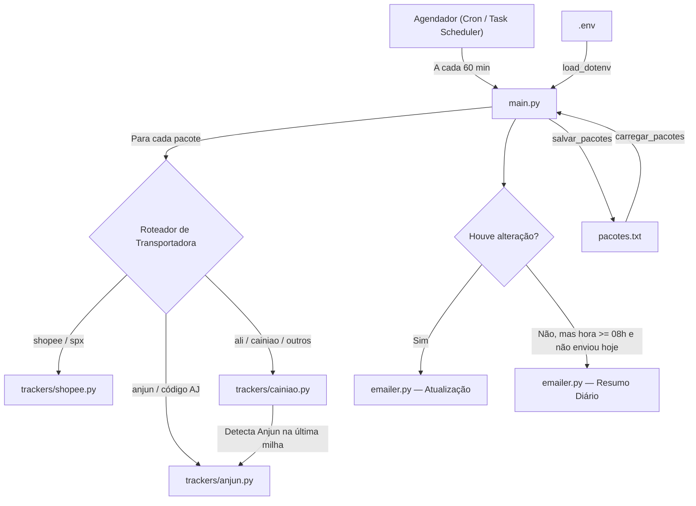

# 📦 Monitor de Rastreamento de Encomendas

Robô de monitoramento de fretes em Python que rastreia pacotes de múltiplos e-commerces e transportadoras, detecta mudanças de status e envia notificações automáticas por e-mail.

## ✨ Funcionalidades

- 🔍 **Rastreamento multi-transportadora** — AliExpress/Cainiao, Shopee Express (SPX) e Anjun Express Brasil
- 🔗 **Detecção automática de última milha** — identifica handoff para Correios ou Anjun em encomendas internacionais
- 📧 **Notificação inteligente por e-mail** — dispara somente quando há atualização de status *ou* no primeiro ciclo após as 08h (resumo diário), evitando spam
- 🗂️ **Persistência em arquivo de texto simples** — sem banco de dados; estado salvo no próprio `pacotes.txt`
- 🖥️ **Multiplataforma** — Windows (Task Scheduler + `run.bat`) e Linux (cron + `run.sh`)
- 🔐 **Sem dependências criptográficas externas** — autenticação RSA da Anjun implementada em Python puro (`pow`)

## 🏗️ Arquitetura



## 📋 Pré-requisitos

- Python 3.10+
- Acesso a um servidor SMTP (Gmail, Outlook, relay corporativo, etc.)

## 🚀 Instalação

### 1. Clone o repositório

```bash
git clone https://github.com/seu-usuario/monitor-rastreamento.git
cd monitor-rastreamento
```

### 2. Instale as dependências

**Windows (venv recomendado):**
```powershell
python -m venv venv
.\venv\Scripts\activate
pip install -r requirements.txt
```

**Linux (Debian 12 / Ubuntu 24 com PEP 668):**
```bash
python3 -m venv venv
source venv/bin/activate
pip install -r requirements.txt
```

> **Alternativa no Linux sem venv:**
> ```bash
> sudo apt install python3-requests python3-dotenv
> ```

### 3. Configure as variáveis de ambiente

```bash
cp .env.example .env
```

Edite o `.env` com suas credenciais SMTP (veja a seção [Configuração](#-configuração)).

### 4. Adicione seus pacotes

Edite o arquivo `pacotes.txt` seguindo o formato:

```
# Arquivo de pacotes monitorados
# Formato: CODIGO | DESCRICAO | ULTIMO_STATUS | ULTIMA_DATA_HORA | LOCALIDADE

NN463625675BR   | mouse (aliexpress)    | | |
BR2650672115828 | poliseal A4 (shopee)  | | |
AJ12345678      | fone anjun            | | |
```

> **Dica:** Inclua palavras-chave na descrição (`shopee`, `spx`, `ali`, `cainiao`, `anjun`) para o roteador identificar a transportadora correta sem depender do formato do código.

### 5. Teste manualmente

```bash
python main.py --force
```

A flag `--force` ignora as regras de agendamento e envia o e-mail imediatamente — ideal para validar a configuração.

## 🔧 Configuração

Todas as configurações ficam no arquivo `.env`. Copie `.env.example` como ponto de partida.

| Variável | Padrão | Obrigatório | Descrição |
|---|---|---|---|
| `EMAIL_HOST` | — | **Sim** | Host SMTP (`smtp.gmail.com`, `smtp.empresa.gov.br`, ...) |
| `EMAIL_PORT` | `587` | Não | Porta SMTP (`587` TLS, `465` SSL, `25` sem criptografia) |
| `EMAIL_HOST_USER` | — | Depende | Usuário de autenticação SMTP |
| `EMAIL_HOST_PASSWORD` | — | Depende | Senha ou App Password da conta SMTP |
| `EMAIL_FROM` | — | Não | Endereço `From:` (útil em relays corporativos) |
| `EMAIL_DESTINATARIO` | — | **Sim** | E-mail de destino das notificações |
| `EMAIL_USE_TLS` | `True` | Não | Habilita STARTTLS |
| `EMAIL_USE_SSL` | `False` | Não | Habilita SMTP_SSL direto |

### Exemplo Gmail com App Password

```dotenv
EMAIL_HOST=smtp.gmail.com
EMAIL_PORT=587
EMAIL_HOST_USER=seuemail@gmail.com
EMAIL_HOST_PASSWORD=xxxx xxxx xxxx xxxx   # App Password gerada em myaccount.google.com
EMAIL_USE_TLS=True
EMAIL_USE_SSL=False
EMAIL_DESTINATARIO=destino@exemplo.com
```

## ⏰ Agendamento Automático

### Windows — Task Scheduler

Execute o script PowerShell **uma única vez** como Administrador:

```powershell
Set-ExecutionPolicy -Scope Process -ExecutionPolicy Bypass
.\setup_scheduler.ps1
```

Isso cria a tarefa `MonitorRastreio` que executa `run.bat` a cada 1 hora indefinidamente.

### Linux — Cron

```bash
chmod +x run.sh
crontab -e
```

Adicione a linha:
```cron
0 * * * * /caminho/completo/para/monitor-rastreamento/run.sh
```

## 📂 Estrutura do Projeto

```
monitor-rastreamento/
├── main.py                # Orquestrador principal
├── emailer.py             # Cliente SMTP e formatação de relatórios
├── pacotes.txt.example    # Exemplo de arquivo de pacotes (crie pacotes.txt a partir daqui)
├── requirements.txt       # Dependências Python mínimas
├── run.bat                # Script de execução — Windows
├── run.sh                 # Script de execução — Linux
├── setup_scheduler.ps1    # Configuração do Task Scheduler — Windows
├── .env.example           # Modelo de configuração de credenciais
├── .gitignore
├── ADR.md                 # Architectural Decision Records
├── AGENTS.md              # Guia técnico para agentes de IA e mantenedores
└── trackers/
    ├── __init__.py
    ├── shopee.py           # Tracker Shopee Express (SPX)
    ├── cainiao.py          # Tracker AliExpress / Cainiao Global
    └── anjun.py            # Tracker Anjun Express Brasil (RSA puro)
```

## 🧩 Adicionando uma Nova Transportadora

1. Crie `trackers/<nome>.py` implementando a função padrão:

```python
def track_<nome>(tracking_code: str) -> dict:
    return {
        "codigo": tracking_code,
        "transportadora": "Nome da Transportadora",
        "status": "...",
        "data_hora": "YYYY-MM-DD HH:MM",
        "detalhes": "...",
        "local": "Cidade - UF (País)",
        "link": "https://...",
        "sucesso": True,
    }
```

2. Exporte em `trackers/__init__.py`
3. Adicione a regra de roteamento em `main.py` → função `rastrear_pacote()`
4. Teste com `python main.py --force`

Veja o guia completo em [AGENTS.md](AGENTS.md).

## 🛟 Solução de Problemas

| Sintoma | Causa | Solução |
|---|---|---|
| `553 5.7.1 Sender address rejected` | Relay SMTP rejeitou o `From:` | Configure `EMAIL_FROM` com endereço autorizado |
| `UnicodeEncodeError: 'charmap'` | Windows em background sob CP1252 | `sys.stdout.reconfigure(encoding="utf-8")` já está em `main.py`; verifique se `run.bat` usa `chcp 65001` |
| `externally-managed-environment` (Linux) | PEP 668 ativo no Debian 12/Ubuntu 24 | Use `python3 -m venv venv` ou instale via `apt` |
| Anjun retorna `sucesso: False` | Pacote ainda na China, não recebido pela Anjun BR | Esperado — Cainiao exibirá eventos internacionais até o desembarque |

## 📄 Licença

MIT — veja o arquivo [LICENSE](LICENSE) para detalhes.

## 🤝 Contribuindo

Contribuições são bem-vindas! Abra uma *issue* para discutir a mudança antes de enviar um PR.

1. Faça um fork do projeto
2. Crie um branch: `git checkout -b feat/nova-transportadora`
3. Commit suas mudanças: `git commit -m 'feat: adiciona tracker Jadlog'`
4. Push: `git push origin feat/nova-transportadora`
5. Abra um Pull Request
